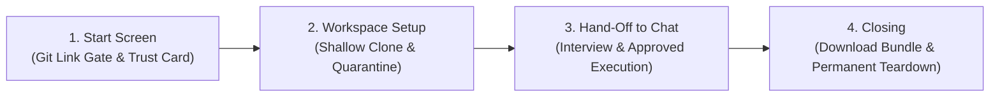

# LabOps Deploy Assistant 🚀

An interactive, trustworthy deployment assistant powered by open-weight models that containerizes repositories, executes builds in isolated sandboxes, and verifies application endpoints — with human-in-the-loop approval on every action.

A **Git link as a hard gate** keeps the user's computer completely out of the picture, separating our product from tools that run on the host with dangerous access to local files and environment variables.

---

## 🧭 The 4-Step Product Flow



### 1. Start Screen (The Hard Gate)
- **One field**: *"Paste a link to a Git repository"*.
- **Validation**: Enforces `https://` only, recognizable repository format, rejects personal access tokens / credentials.
- **Badge**: *"Public repositories only for now"*.
- **Reassurance**: *"It can download things, but it can't reach your computer or your accounts."*
- **Trust Card Copy**:
  > **A private workspace, just for this.** Your project is copied into a temporary workspace, separate from your computer and your accounts.  
  > **Gone when you're done.** When you close this session, the workspace and everything in it is deleted.  
  > **No secrets needed.** Don't paste passwords or keys. I won't ask for them, and I skip files that usually hold them.  
  > **One thing to know:** to understand your project, I read your files and send their text to an AI model.

### 2. Setting Up Your Workspace (Live Setup Screen)
Runs while the shallow clone and inspection execute, presenting live status lines with a one-sentence reassurance:
- *"Opening a fresh workspace…"* (Preparing an isolated, ephemeral sandbox)
- *"Downloading your project from GitHub…"* (Shallow clone with `--depth 1` and timeout)
- *"Setting aside files that might hold secrets…"* (Scans and quarantines `.env`, `.pem`, key files so the AI never sees them)
- *"Taking a look at what's inside…"* (Manifest and architecture inspection)
- *"Ready. This looks like a Node app."* (or Python FastAPI app)

### 3. Hand-Off to Chat
- Assistant opens immediately with what it found: *"This looks like a Node app with an Express server and package.json dependencies."*
- Initiates the brief interview: companion databases (Postgres, MongoDB, Redis, None), ports, environment variables.
- Proposes configuration files (`Dockerfile`, `docker-compose.yml`, `.env.example`) and build commands (`run_command`), pausing for explicit developer approval.

### 4. Closing & Permanent Deletion
- Before workspace deletion, offers **"Download your files"** (a complete ZIP bundle containing `Dockerfile`, `docker-compose.yml`, `.env.example`, and `DEPLOY_RUNBOOK.md`).
- Confirms workspace deletion: displays verifiable confirmation that the container and workspace files have been permanently destroyed.

---

## 🔒 Security Promises & Architecture

| Product Promise | How We Enforce It |
|---|---|
| **Separate from your computer** | Runs in disposable isolated workspaces. Mounts nothing from the host machine. Strips all host environment variables. |
| **No secrets needed** | Tool executor strictly refuses to read `.env`, `.env.*`, `*.pem`, `*.key`, `id_rsa`, credentials. Creates `.env.example` with placeholder values instead. |
| **Gone when you're done** | Explicit session deletion endpoint and 60-minute idle auto-cleanup purge containers and files completely. |
| **Public repositories only** | Rejects tokens or SSH authentication URLs upfront to prevent credential leakage. |
| **Shallow & constrained clone** | Clones with `--depth 1`, 50-second timeout, and 100MB repository limit. |
| **The Stop Rule** | If a build fails due to a bug in the user's app code (SyntaxError, missing import), quotes the error verbatim and halts instead of guessing fixes. |

---

## ⚡ Quick Start

### Option 1: Docker Compose (All-in-One)

```bash
cd "hacktober fest"
docker compose up --build
```
- **Frontend Dashboard**: [http://localhost:3000](http://localhost:3000)
- **Backend API Docs**: [http://localhost:8000/docs](http://localhost:8000/docs)
- **Interactive Sandbox Terminal**: Built-in side-by-side terminal connected to DinD container.

---

### Option 2: Local Development

#### 1. Backend (FastAPI)
```bash
cd "hacktober fest/backend"
python -m venv venv
# Windows:
venv\Scripts\activate
# Linux/macOS:
source venv/bin/activate

pip install -r requirements.txt
uvicorn app.main:app --reload --port 8000
```

#### 2. Frontend (React + Vite + Tailwind)
```bash
cd "hacktober fest/frontend"
npm install
npm run dev
```

---

## 🧪 Built-in Test Fixtures

Test fixtures under `backend/fixtures/` allow instant one-click validation directly from the Start Screen:
1. `sample-node-app`: Working Express.js REST service.
2. `sample-python-app`: Working FastAPI microservice with database configuration.
3. `broken-app`: A project containing a deliberate syntax error to test the **Stop Rule** (detects application code failure vs. deployment configuration).
