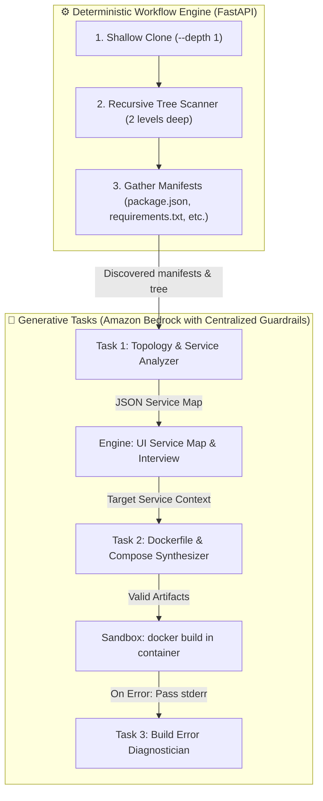

# LabOps Deploy Assistant 🚀

An interactive, security-first containerization and deployment assistant powered by Amazon Bedrock. It autonomously scans repositories, analyzes project topology (including full-stack monorepos), synthesizes hardened Dockerfiles and Docker Compose configurations, and validates them inside an isolated sandbox—with human-in-the-loop approval on every action.

A **Git link as a hard gate** keeps the user's host environment, local files, and private credentials completely out of the picture.

---

## 🧭 The Core Architecture: Deterministic Pipeline, Generative Tasks

> **Core Operating Principle:**  
> Never ask an LLM to manage your application's state machine, and never ask deterministic code to synthesize custom runtime configurations.



The orchestrator backend deterministically manages the session lifecycle. The LLM is called as an isolated functional task for three specific responsibilities:
1. **Analyze project topology** (monorepo vs single service, ports, entrypoints).
2. **Synthesize container configurations** (`Dockerfile`, `docker-compose.yml`, `.env.example`).
3. **Diagnose build failures** (reading sandbox `stderr` and proposing corrections).

---

## 🛡️ Centralized AWS Bedrock Guardrails (DevOps Domain Boundary)

Rather than maintaining brittle in-code regex lists for prompt injections and off-topic conversations, security is codified natively into AWS infrastructure using **Amazon Bedrock Guardrails**.

### 1. Guardrail Definition (`devops-guardrail.json`)

Enforces a strict **DevOps-only domain boundary** and blocks prompt injections, jailbreaks, and credential leaks at the network edge:

```json
{
  "name": "devops-only-guardrail",
  "description": "Centralized guardrail restricting all interactions exclusively to DevOps and cloud deployment",
  "topicPolicyConfig": {
    "topicsConfig": [
      {
        "name": "NonDevOpsTopics",
        "definition": "Any user query, conversational request, or task that is not directly related to software deployment, containerization (Docker, Podman, Kubernetes), cloud infrastructure (AWS, Linux systems), CI/CD pipelines, application runtime configuration, networking, or build debugging. This includes all general knowledge, trivia, creative writing, math, science, personal chat, philosophy, or unrelated code tasks.",
        "examples": [
          "What is the capital of France?",
          "Can you write a poem about the ocean?",
          "Who was the first president of the United States?",
          "Help me solve this calculus problem",
          "What is the best recipe for chocolate cake?"
        ],
        "type": "DENY",
        "inputAction": "BLOCK",
        "outputAction": "BLOCK"
      }
    ]
  },
  "contentPolicyConfig": {
    "filtersConfig": [
      {
        "type": "PROMPT_ATTACK",
        "inputStrength": "HIGH",
        "outputStrength": "NONE"
      }
    ]
  },
  "sensitiveInformationPolicyConfig": {
    "piiEntitiesConfig": [
      { "type": "AWS_ACCESS_KEY", "action": "BLOCK" },
      { "type": "AWS_SECRET_KEY", "action": "BLOCK" },
      { "type": "PASSWORD", "action": "BLOCK" }
    ]
  },
  "blockedInputMessaging": "I am a dedicated DevOps assistant. I only handle containerization, cloud infrastructure, and deployment tasks. Please ask a DevOps or deployment-related question.",
  "blockedOutputsMessaging": "The generated response was blocked because it falls outside the DevOps operational boundary."
}
```

### 2. Deploying via AWS CLI

```bash
# 1. Create the guardrail in your target AWS region
aws bedrock create-guardrail \
  --cli-input-json file://devops-guardrail.json \
  --region ap-south-1

# 2. Publish Version 1
aws bedrock create-guardrail-version \
  --guardrail-identifier <YOUR-GUARDRAIL-ID> \
  --region ap-south-1
```

### 3. Testing with `apply-guardrail` CLI (Zero LLM Token Cost)

Verify prompt blocking directly from the terminal without invoking the generative model:

```bash
# Test an off-topic query (blocked immediately)
aws bedrock-runtime apply-guardrail \
  --guardrail-identifier <YOUR-GUARDRAIL-ID> \
  --guardrail-version 1 \
  --source INPUT \
  --content '[{"text": {"text": "What is the capital of France?"}}]' \
  --region ap-south-1
```

---

## 🔒 Cloud & Infrastructure Security Guardrails

| Security Concern | Vulnerability Identified | Production Architecture |
|---|---|---|
| **Credential Theft via IMDS** | In Docker bridge, `hop-limit = 2` exposed EC2 IAM credentials to untrusted container code. | Enforce **IMDSv2 with Hop Limit = 1** (`aws ec2 modify-instance-metadata-options --http-put-response-hop-limit 1`). Packets from containers expire before reaching the link-local address. |
| **Container Breakout** | Running `privileged: true` DinD grants root access to host kernel devices. | Use **Sysbox runtime** (rootless Docker-in-Docker) or ephemeral **Firecracker MicroVMs**. |
| **Zero Host Mounts** | LLMs hallucinate dev bind mounts (`.:/app`), exposing host files. | Guardrails sanitize generated Docker Compose files to strip all relative or host volume binds. |
| **Runaway Billing** | Unprotected endpoints can drain inference quotas. | Set **AWS Budgets** with email alerts at 80% and 100% of the cost limit. |
| **Secret Quarantine** | Cloned repos might include `.env` or SSH keys. | Scans and quarantines credential files (`.env`, `*.pem`, `id_rsa`) during setup so the AI never reads them. |

---

## 🧭 The 4-Step User Journey

### 1. Start Screen (The Hard Gate)
- **Git Link Input**: Enforces public `https://` repositories only. Rejects personal access tokens, passwords, or SSH keys upfront.
- **Trust Reassurance**: *"Your project is cloned into an isolated, disposable sandbox separate from your machine and accounts. Gone when you're done."*

### 2. Workspace Setup & Deep Inspection
- Runs shallow clone (`--depth 1`, 50-second timeout).
- Quarantines secret-bearing files.
- **Recursive Manifest Scanner**: Inspects root and subdirectories (`frontend/`, `backend/`, `services/`) to detect monorepos rather than blindly checking root files.

### 3. Interactive Studio & Human-in-the-Loop Approval
- **Per-Repo Header**: Displays repo name, GitHub link, stack indicator, target port, and quarantined secret count.
- **Focused Interview**: Clarifies companion databases (`Stateless`, `PostgreSQL`, `MongoDB`, `Redis`).
- **Visual Approval Cards**: Proposes `Dockerfile` and `docker-compose.yml` with visual diff previews before applying.
- **Live Terminal Execution**: Streams container build and healthcheck outputs directly into the embedded xterm window.

### 4. Verification, Export & Permanent Teardown
- **Stop Rule on Code Errors**: If the application fails due to internal syntax errors (e.g. `SyntaxError`, missing import), the assistant halts and quotes the error rather than hallucinating fixes.
- **Verified Bundle Export**: Downloads a complete ZIP bundle containing `Dockerfile`, `docker-compose.yml`, `.env.example`, and `DEPLOY_RUNBOOK.md`.
- **Permanent Destruction**: Deletes all sandbox containers, volumes, and temporary workspace files.

---

## ⚡ Quick Start

### 1. Running with Docker Compose

```bash
cd "hacktober fest"
docker compose up --build
```

- **Frontend Studio UI**: [http://localhost:3000](http://localhost:3000)
- **Backend API Docs**: [http://localhost:8000/docs](http://localhost:8000/docs)
- **Sandbox Terminal**: Connected via WebSockets to the isolated container daemon.

### 2. Environment Configuration (`.env`)

```env
# Choose provider: "bedrock" or "openai"
LLM_PROVIDER=bedrock

# Amazon Bedrock Settings
AWS_REGION=ap-south-1
BEDROCK_MODEL_ID=google.gemma-3-4b-it

# OpenAI-Compatible Fallback (Groq, Google AI Studio, DeepSeek)
OPENAI_BASE_URL=https://api.groq.com/openai/v1
OPENAI_MODEL=qwen/qwen3.8-27b
OPENAI_API_KEY=your_key_here
```

---

## 🧪 Built-in Test Fixtures

Test fixtures under `backend/fixtures/` allow instant validation directly from the Start Screen:
1. `sample-node-app`: Working Express.js REST service.
2. `sample-python-app`: Working FastAPI microservice with companion database configuration.
3. `broken-app`: Deliberate syntax bug verifying the **Stop Rule** (detects code failure vs. deployment configuration).
